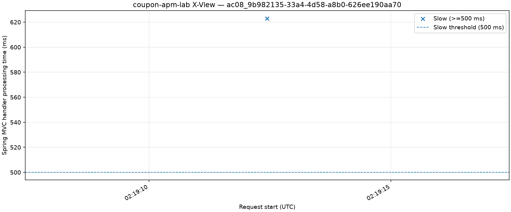

# 쿠폰 발급 경쟁 조건과 경량 APM 검증

**통합 기술 검증 보고서 · 2026-11-10**  
Java 21 · Spring Boot · PostgreSQL · Locust

## 요약

이 저장소는 PostgreSQL 기반 쿠폰 발급의 경쟁 조건을 다루고, Spring MVC 요청을 관측하는 경량 APM과 X-View를 직접 구현한 프로젝트다. 이 보고서는 기능 검증과 APM의 관측·성능 결과를 AC01~AC11로 정리한다.

| 읽기 요점 | 결과 |
|:--|:--|
| **만든 것** | DB 행 잠금·고유성 제약을 이용한 쿠폰 발급과, 느린 요청을 기록하고 X-View로 보여주는 경량 APM |
| **검증한 것** | AC01~AC06 및 AC08~AC11은 기록된 범위에서 PASS. 재고 30개에 사용자 100명이 요청한 시험은 성공 30건·품절 70건으로 DB 상태와 일치했고, 실제 PostgreSQL 잠금 대기도 관측했다. |
| **성능 측정** | AC07 공식 결과는 1차 PASS, 2차 FAIL, 3차 PASS. 추가 재측정도 PASS지만 공식 결과에 합치지 않았다. 네 배치 모두 `REVIEW_REQUIRED`다. |
| **아직 입증하지 못한 것** | 성능이 실행환경 전반에서 안정적으로 유지되는지, 2차 p95 급등의 원인이 무엇인지는 미확정이다. 각 배치의 APM ON/OFF 표본은 3회이며 통계적 유의성 검정·신뢰구간을 산출하지 않았다. |

공식 AC07 측정에서는 호스트 전체·프로세스별 CPU를 수집하지 않았다. 실패 당시 다른 CPU 작업이 있었다는 회고는 가능한 설명일 뿐 원인 증거가 아니다. app·DB 자원 지표와 GC 로그는 별도 동기·비동기 로깅 진단에서만 수집했으므로 공식 배치의 원인을 설명하지 못한다. 공개 증거에는 요청별 원시 자료가 모두 포함되지 않아, 공개 파일만으로 요청 단위 p95를 다시 계산할 수도 없다. 별도 진단의 p95 차이는 +0.38%로 로깅 병목 가설을 지지하지 않았다.

이 문서는 **11개 인수조건의 검증을 한 편에 통합**한다. 원본 파일과 실행 기록은 마지막 ‘증거 자료’ 절에서 번호로 연결했다. 자료 번호 `[E01]` 등은 해당 절의 목록을 참조한다.

## 1. 실험 설계와 판정 원칙

쿠폰 발급 요청은 PostgreSQL 트랜잭션에서 쿠폰 행을 잠근 다음, 이미 발급한 사용자인지 검사하고 재고가 남아 있으면 발급 이력과 발급 수량을 함께 갱신한다. DB에는 쿠폰·사용자 조합에 대한 고유성 제약과 발급 수량 상한 제약도 둔다. **HTTP 성공 응답만으로 정합성을 판정하지 않고 실제 DB 이력·발급 수량을 대조**한다.

APM은 지정된 Spring MVC 처리 구간을 계측한다. 기본 감시 주기는 100ms, 느린 요청 임계값은 500ms, Stack 기록 상한은 64프레임이다. APM 내부 경과시간은 **Locust가 측정하는 클라이언트 응답시간과 측정 구간이 다르다**. 두 값을 직접 빼서 특정 처리 단계의 비용으로 확정하지 않는다.

### 쿠폰 동시성 흐름

```text
동시 발급 요청
    ↓
PostgreSQL 트랜잭션 · 쿠폰 행 잠금 (PESSIMISTIC_WRITE)
    ↓
중복 확인 ── 이미 발급됨 → 중복 응답
    ↓ 아니오
재고 확인 ── 재고 없음 → 품절 응답
    ↓ 있음
발급 이력 저장 + issued_count 갱신 → 같은 트랜잭션으로 커밋

DB 제약: (coupon_id, user_id) UNIQUE · 발급 수량 상한
```

### APM 관측 흐름

```text
Spring MVC 요청 시작 ── Thread 참조를 활성 요청으로 등록
    ├─ 요청 완료 → 트랜잭션 기록 → X-View (최대 1,000건)
    └─ 100ms 주기 Monitor
          ├─ 500ms 초과 → Stack 캡처 → SlowTrace (최대 100건)
          └─ 캡처 전 요청 완료 → COMPLETION_FALLBACK으로 보완
요청 종료 finally → 활성 요청 제거 · Thread 참조 해제
```

검증 결과를 다음처럼 구분했다.

| 구분 | 의미 |
|:--|:--|
| `PASS` | 해당 인수조건의 기록된 검증 범위에서 기대 결과 충족 |
| `FAIL` | 유효한 실험에서 하나 이상의 목표 위반 |
| `VALID` | 실험의 정합성·데이터 검증 조건 충족. 성능 목표 통과와는 별개 |
| `REVIEW_REQUIRED` | 측정 간 편차가 사전 기준 초과. 유효한 결과를 폐기한다는 뜻은 아님 |

2026-11-09의 보존된 실행 기록에는 **JUnit 단위 8건·실제 PostgreSQL 통합 12건, 총 20건 통과**가 남아 있다. 별도의 2026-11-10 재검증에서는 `./gradlew clean build`가 단위 테스트 **11건**을, 이어 실행한 `./gradlew integrationTest`가 PostgreSQL 통합 테스트 **12건**을 통과했다. 두 명령의 결과는 최신 소스 기준 검증이며, 하나의 Gradle 명령에서 총 23건을 실행한 것으로 합산하지 않는다. [E01]

## 2. 인수조건별 검증 결과

| 인수조건 | 검증 항목 | 판정 |
|:--|:--|:--|
| AC01 | 서로 다른 사용자 100명 동시 발급 | PASS |
| AC02 | 같은 사용자 20건 중복 요청 | PASS |
| AC03 | 품절·중복·입력 오류의 일관성 | PASS |
| AC04 | 500ms 임계값 및 보완 캡처 | PASS |
| AC05 | 중복 없는 Stack 캡처·경합 처리 | PASS |
| AC06 | X-View·SlowTrace 보관 상한 | PASS |
| AC07 | APM ON/OFF 성능 영향 | **1차 PASS / 2차 FAIL / 3차 PASS, 모두 REVIEW_REQUIRED** |
| AC08 | 실제 PostgreSQL 잠금과 APM 관측 | PASS |
| AC09 | 3초 잠금 타임아웃과 롤백 | PASS |
| AC10 | 종료 시 활성 요청·Thread 참조 정리 | PASS |
| AC11 | APM ON/OFF 업무 결과 불변 | PASS |

### AC01 — 재고 30개에 서로 다른 사용자 100명이 동시에 요청한다

**검증 방법.** 재고 30개인 쿠폰을 준비하고 서로 다른 사용자 100명의 발급 작업을 동시에 시작했다. 테스트는 이를 **독립된 쿠폰으로 3회** 반복했다.

**관찰 결과.** 매회 성공 **30건**, 품절 **70건**, 중복 **0건**, 잠금 타임아웃 **0건**이었다. 발급 이력 수와 쿠폰의 `issued_count`도 각각 **30**이었다. 한 번의 성공 응답 집계가 아니라 **실제 커밋 상태까지 일치**한다는 점이 판정 근거다.

**판정: PASS.** 이 부하 조건에서 초과 발급은 관찰되지 않았다. 모든 가능한 동시성 스케줄을 증명한 결과는 아니다. [E01]

### AC02 — 동일 사용자의 동시 요청 20건은 한 번만 발급된다

**검증 방법.** 재고 30개인 쿠폰에 동일 사용자 식별자로 **20건**을 동시에 요청하고, 이를 3회 반복했다. 재고가 충분한 상황을 만들었으므로 다른 19건이 실패하는 이유는 품절이 아니라 **중복 발급 제한**이어야 한다.

**관찰 결과.** 매회 성공 **1건**, 중복 **19건**, 잠금 타임아웃 **0건**이었다. 발급 이력과 `issued_count`는 **1**이었다. 애플리케이션의 중복 검사 외에도 DB의 `UNIQUE (coupon_id, user_id)` 제약이 중복 이력 저장을 제한한다.

**판정: PASS.** 동일 사용자에게 두 장이 커밋되는 현상은 이 시험에서 발생하지 않았다. [E01]

### AC03 — 품절·중복 판단과 실패 시 DB 상태가 일치한다

**검증 방법.** 재고 0개 쿠폰에 발급을 시도하고, 재고 1개 쿠폰을 이미 발급한 사용자와 다른 사용자로 각각 재요청했다. 비어 있거나 공백뿐인 식별자, 허용 길이를 넘긴 식별자도 검사했다.

**관찰 결과.** 품절은 `COUPON_SOLD_OUT`으로 거절되었고 이력·발급 수량은 **0**으로 유지됐다. 마지막 한 장을 받은 사용자가 다시 요청하면 재고가 0이어도 **`COUPON_ALREADY_ISSUED`가 우선**했다. 다른 사용자 요청은 품절로 처리됐다. 잘못된 식별자는 `INVALID_REQUEST`로 거절됐다.

**판정: PASS.** 오류 응답 우선순위와 DB 상태 불변 조건이 검증됐다. HTTP 수준에서는 잘못된 식별자에 400, 존재하지 않는 쿠폰에 404를 반환하는 것도 확인했다. [E01]

### AC04 — 500ms 이상 요청을 놓치지 않고 느린 요청으로 기록한다

**검증 방법.** 재현 가능한 인공 시계를 이용해 **499ms, 500ms, 550ms** 경과를 각각 만들었다. 550ms 조건에서는 마지막 Monitor 검사 이후 요청이 완료되도록 설정했다.

**관찰 결과.** **499ms** 요청은 SlowTrace를 만들지 않았다. **500ms**에서는 경계값을 포함해 기록했고, **550ms**에서도 주기적 검사 사이에 완료된 요청을 `COMPLETION_FALLBACK`으로 보완 기록했다.

**판정: PASS.** 임계값 경계와 검사 간격의 빈틈을 보완하는 로직을 검증했다. 499/500/550ms는 **실제 외부 부하 측정값이 아닌 제어된 테스트 시간**이다. [E01]

### AC05 — 한 요청의 Stack을 중복 캡처하지 않는다

**검증 방법.** 느린 요청에 대해 Monitor 캡처와 완료 처리를 겹치게 실행했다. 캡처 작업이 진행 중인 동안 완료가 들어오는 경우와, Stack 수집 자체가 실패하는 경우도 별도로 구성했다.

**관찰 결과.** Monitor가 먼저 캡처한 요청은 **Stack 수집 1회·SlowTrace 1건**으로 끝났고, 기록한 프레임 수는 **1~64개** 범위였다. 진행 중인 캡처가 끝난 다음 활성 요청을 정리했다. 수집 실패도 실패 상태로 기록하고 활성 목록을 비웠다.

**판정: PASS.** 제어된 경합·실패 조건에서 중복 기록과 미정리 활성 요청은 관찰되지 않았다. [E01]

### AC06 — 관측 데이터가 무한히 쌓이지 않는다

**검증 방법.** X-View 저장소에 **1,200건**을 순서대로 넣고 최신 1,000건만 유지되는지 확인했다. SlowTrace 저장소에는 **110건**을 넣어 최근 100건만 남는지 확인했다. 읽기·쓰기 경쟁 조건은 8개 작업이 각각 500회 저장하며 보관 용량 50을 넘지 않는지 확인했다.

**관찰 결과.** X-View는 **201~1,200번**, SlowTrace는 **11~110번** 항목을 유지했다. 반환된 목록은 변경 불가능했고, 동시 접근 중에도 보관 수가 설정 상한을 넘지 않았다.

**판정: PASS.** 메모리 보관 **항목 수**가 상한을 지키는 것을 검증했다. 전체 JVM 메모리 사용량에 대한 장기 검증은 아니다. [E01]

### AC07 — APM을 켰을 때 성능 영향이 허용 범위 안에 있는가

#### 결과 요약

| 배치 | 구분 | p95 변화 | 성공 TPS 변화율 | 목표 | 편차 |
|:--|:--|--:|--:|:--|:--|
| `110901308de535` | 공식 1차 | −16.04% | −0.88% | PASS | REVIEW_REQUIRED |
| `1109034678e297` | 공식 2차 | **+309.71%** | +1.28% | **FAIL** | REVIEW_REQUIRED |
| `110923334c54bc` | 공식 3차 | +1.11% | −0.41% | PASS | REVIEW_REQUIRED |
| `11092304b3ccfc` | 추가 재측정 | −9.21% | −0.49% | PASS | REVIEW_REQUIRED |

배치별로 APM OFF 3회와 ON 3회를 비교했다. 표본이 적고 신뢰구간이나 통계적 유의성 검정을 산출하지 않았으므로, PASS 배치만으로 반복 가능한 성능 보장을 결론 내릴 수 없다. 공식 측정 당시 호스트 전체·프로세스별 CPU 사용량도 수집하지 않았다. 특히 2차 실패 원인을 CPU 경합으로 확정할 수 없다. 추가 재측정은 공식 1·2·3차와 별도로 보존한다. [E07] [E09] [E15] [E20]

#### 측정 조건과 판정 기준

**검증 방법.** Locust 가상 사용자 최대 **100명**, 초당 **10명**씩 증가, 요청 사이 대기 **0.1~0.3초** 조건을 사용했다. 실행마다 **워밍업 60초 + 측정 60초**이며, 사전 6회·정식 6회를 배치별로 실행했다. 정식 순서는 `OFF → ON → ON → OFF → OFF → ON`이다.

실행마다 독립 PostgreSQL **데이터베이스**와 새 애플리케이션 프로세스를 사용했다. 같은 실행의 워밍업과 측정은 **같은 DB·프로세스**를 유지했다. DB가 분리돼도 같은 PostgreSQL 인스턴스의 CPU·WAL·디스크 I/O까지 분리되는 것은 아니다.

비교 대상은 **커밋과 대조된 성공 TPS** 및 성공 요청에 대한 클라이언트 p95(Nearest-Rank)이다. OFF/ON 각 3회 중앙값의 p95 증가율과 TPS 감소율이 **각각 15% 이하**여야 한다. 동일 모드의 최대/최소 비율이 **1.15 초과**이면 유효성 여부와 별도로 편차 검토를 표시한다.

#### 배치별 상세 기록

| 공식 배치 | OFF p95 | ON p95 | p95 변화 | 성공 TPS OFF → ON | 목표 | 편차 |
|:--|--:|--:|--:|:--|:--|:--|
| 1차 `110901308de535` | 8.337ms | 6.999ms | −16.04% | 447.50 → 451.45 | PASS | REVIEW_REQUIRED |
| 2차 `1109034678e297` | 5.582ms | 22.872ms | **+309.71%** | 451.67 → 445.90 | **FAIL** | REVIEW_REQUIRED |
| 3차 `110923334c54bc` | 5.340ms | 5.399ms | **+1.11%** | 452.13 → 454.00 | **PASS** | REVIEW_REQUIRED |

같은 측정 절차로 실행한 유효한 **추가 배치** `11092304b3ccfc`는 공식 1·2·3차와 구분해 보존한다. OFF/ON p95 중앙값은 5.00379/4.54271ms, p95 변화는 −9.21%였고, 성공 TPS 중앙값은 452.55/454.78, TPS 감소율은 −0.49%였다. 목표는 PASS, 편차는 `REVIEW_REQUIRED`다. 이 추가 배치의 여섯 정식 회차도 모두 VALID다.

##### 추가 재측정 회차

| 순서 | APM | p95(ms) | 성공 TPS | 유효성 |
|--:|:--:|--:|--:|:--|
| 01 | OFF | 6.12096 | 450.75 | VALID |
| 02 | ON | 4.31329 | 455.70 | VALID |
| 03 | ON | 4.54271 | 454.78 | VALID |
| 04 | OFF | 4.78317 | 452.55 | VALID |
| 05 | OFF | 5.00379 | 454.08 | VALID |
| 06 | ON | 4.93929 | 451.25 | VALID |

이 추가 배치도 OFF 회차 p95의 최대/최소 비율이 1.15 검토선을 넘어 편차 검토가 필요하다. 공식 3차와 평균하거나 그 결과를 대체하지 않는다. 공식 세 배치와 추가 재측정의 정식 회차는 실행 ID로 구분해 보존했다. [E18] [E20] [E21]

##### 공식 2차 FAIL 회차

2차 배치에서 TPS는 **1.28% 감소**해 기준을 충족했다. 그러나 p95 기준만 실패했다. 아래는 2차 **정식 6회**의 개별 기록이다.

| 순서 | APM | p95(ms) | 성공 TPS | 유효성 |
|--:|:--:|--:|--:|:--|
| 01 | OFF | 5.639 | 451.67 | VALID |
| 02 | ON | **22.872** | 436.05 | VALID |
| 03 | ON | 9.506 | 447.90 | VALID |
| 04 | OFF | 5.582 | 452.37 | VALID |
| 05 | OFF | 5.298 | 449.92 | VALID |
| 06 | ON | **23.122** | 445.90 | VALID |

정식 ON 3회 중 **2회**에서 p95가 약 23ms로 상승했고, OFF 3회는 5.3~5.6ms 범위였다. 모든 정식 회차는 HTTP 201과 DB 커밋 대조를 통과했다. **VALID라는 사실이 성능 목표 충족을 의미하지는 않는다.**

1차에서는 사전 검증 한 회차가 무효 처리되어 재시도했으며, 이후 사전 유효 6회·정식 6회를 확보했다. 2차의 사전·정식 12회는 모두 VALID였다. **3차는 원본 ZIP에 포함된 12회 실행별 검증 결과를 확인했고, 사전 6회·정식 6회 모두 VALID**였다. 3차 정식 측정의 성공 응답과 DB 커밋 대조 건수는 각각 **163,163건**으로 일치한다. 사전 측정의 동일 값은 각각 **163,475건**이다. 모든 실행에서 201 응답 건수·측정된 요청 수·커밋된 발급 수가 일치했다.

##### 공식 3차 회차 검증

아래는 3차 **정식 6회**의 원본 측정값이다. p95는 측정 구간의 성공 요청에 대한 값이며, 성공 건수는 각 60초 측정 창에서 검증한 건수다.

| 순서 | APM | p95(ms) | 성공 TPS | 성공·커밋 건수 | 유효성 |
|--:|:--:|--:|--:|--:|:--|
| 01 | OFF | 5.340 | 452.13 | 27,128 | VALID |
| 02 | ON | 5.690 | 454.00 | 27,240 | VALID |
| 03 | ON | 5.295 | 454.02 | 27,241 | VALID |
| 04 | OFF | 4.553 | 455.13 | 27,308 | VALID |
| 05 | OFF | 6.412 | 450.68 | 27,041 | VALID |
| 06 | ON | 5.399 | 453.42 | 27,205 | VALID |

3차 OFF 3회의 p95는 **4.553~6.412ms**로, 최댓값/최솟값 비율이 **1.41**이다. 이는 사전 편차 검토선 **1.15**를 넘기 때문에 목표 PASS와 별도로 `REVIEW_REQUIRED`가 유지된다. ON 3회의 p95는 **5.295~5.690ms**였다. 비교표의 중앙값 **OFF 5.33988ms / ON 5.39937ms**, 성공 TPS **OFF 452.13 / ON 454.00**은 원본 회차별 수치를 재집계했을 때 일치했다.

1차와 3차는 M **306**, 사용자별 쿠폰 수 **612**가 일치한다. 2차는 M **307**, 사용자별 쿠폰 수 **614**였다. 기록된 Git 커밋은 2차와 3차가 동일하다. 따라서 2차와 3차의 판정 차이를 **구현 변경의 효과**로 설명할 수 없으며, 실행환경 차이와 원인 미확정 상태를 유지해야 한다.

**3차 증거 범위.** 공개용으로 보존한 원본 판정 JSON·전체 실행 요약을 배치 비교 CSV와 대조했고, 실행별 manifest와 warm-up/측정 validation 파일을 검증 인덱스로 연결했다. 공식 3차의 12개 실행 디렉터리에서 확인한 **288개 원본 파일**은 프로젝트 밖 전체 증거 백업의 SHA-256 매니페스트와 대조했다. 이전 초안에 있던 “원본 ZIP 295개 파일” 주장은 그 ZIP 원본을 확인할 수 없어 제외했다. 공개용 최소 증거에는 요청별 CSV와 DB 교차검증 상세를 넣지 않으므로 **공개 파일만으로 요청 단위 p95를 독립 재계산할 수는 없다**. 전체 원본은 별도 백업에 보존했다. [E15] [E16] [E17] [E18] [E19]

**판정: 공식 1차 PASS / 2차 FAIL / 3차 PASS. 추가 재측정도 PASS이며, 네 배치 모두 REVIEW_REQUIRED.** 공식 판정은 추가 배치와 합산하지 않는다. 최근 공식 배치의 목표 PASS는 원본 판정과 개별 실행 기록으로 확인했지만, 변동성 검토가 네 배치 모두 남아 있어 안정적인 오버헤드 수준이 입증됐다고 보기는 어렵다. 2차 p95 급등의 원인은 미확정이다. 통과한 배치만 남기거나 실패한 회차를 임의로 이상치로 삭제하지 않는다. [E06] [E07] [E08] [E09] [E15] [E16] [E20] [E21]

### AC08 — 실제 DB 잠금 대기를 APM에서 관찰할 수 있는가

**검증 방법.** 별도 JDBC 연결에서 쿠폰 행을 잠근 상태로 발급 요청을 보냈다. PostgreSQL이 보고한 차단 관계를 확인하고, 잠금이 해제되기 전 APM의 Monitor가 실행 중인 요청의 Stack을 수집하는지 살폈다.

**관찰 결과.** DB에는 `wait_event_type=Lock`과 차단 PID가 나타났으며, JVM Stack은 PostgreSQL JDBC 응답 대기 위치를 가리켰다. Monitor는 요청 시작 후 **546ms**에 Stack을 캡처했다. 잠금을 해제하자 요청은 **HTTP 201**로 종료됐고 X-View에는 **623ms**가 기록됐다. DB 발급 이력·카운터는 각각 1이었다.



*그림 1. PostgreSQL 행 잠금 대기 요청 1건을 기록한 X-View. 전체 부하 분포가 아니다.*

**판정: PASS.** 실제 DB 차단과 APM 캡처가 **같은 시험에서 각각 확인**됐다. 단, 546ms는 캡처 시점까지 경과시간이고 623ms는 계측된 처리시간이다. 둘 다 **순수 잠금 대기시간**은 아니며, 애플리케이션 요청과 PostgreSQL PID가 자동 연결된 사례도 아니다. [E02] [E03] [E04] [E05]

### AC09 — 잠금 대기가 3초를 넘으면 503과 롤백으로 끝나는가

**검증 방법.** AC08처럼 실제 DB 행 잠금을 유지하되, PostgreSQL `lock_timeout`을 **3초**로 설정해 잠금을 얻지 못하도록 했다.

**관찰 결과.** DB 잠금 타임아웃을 받은 요청은 **HTTP 503**, 오류 코드 `COUPON_LOCK_TIMEOUT`으로 반환됐다. 발급 수량은 **0**, 발급 이력도 **0**으로 남았다. 완료 후 활성 요청 목록도 정리됐다.

**판정: PASS.** 예상한 DB 타임아웃이 API 계약대로 변환되고 실패한 거래가 커밋되지 않았음을 확인했다. [E01]

### AC10 — 종료된 요청이 활성 목록과 Thread 참조를 남기지 않는가

**검증 방법.** 정상 완료, 완료 시 보완 Stack 캡처, Monitor 캡처 실패 후 종료 경로를 각각 검사했다. 실제 잠금 대기 통합 시험에서도 요청 완료 후 활성 목록이 비는지 확인했다.

**관찰 결과.** 종료 상태에서 `Thread` 참조가 `null`이 되고 활성 요청 목록이 비었다. 캡처 중 완료가 발생한 경우에도 캡처 종료를 기다린 뒤 정리가 진행됐다. **AC10 직접 검증 3건은 별도 대상 실행에서 통과한 것으로 공유됐다.** 해당 실행의 JUnit XML은 이 공개 후보에 포함되어 있지 않다.

**판정: PASS.** 확인한 것은 명시적 참조 해제와 활성 목록 정리다. 힙 덤프 기반 장기 메모리 누수 부재까지 증명한 것은 아니다. 또한 직접 검증 3건은 보존된 **20건 전체 실행과 별개의 실행**이다. [E01]

### AC11 — APM ON/OFF가 쿠폰 발급의 결과를 바꾸지 않는가

**검증 방법.** APM ON/OFF를 각각 적용해 HTTP 성공·중복·품절 및 재고 동시성을 검사했다. 각 모드에서 **재고 5개에 사용자 12명의 동시 요청**을 수행하고 DB 발급 수량과 이력을 대조했다.

**관찰 결과.** 양쪽에서 재고만큼만 발급됐고 나머지는 품절 처리됐다. 성공은 **HTTP 201**, 중복과 품절은 **HTTP 409**였다. APM OFF 상태에서는 Monitor가 등록되지 않고 X-View 기록이 생성되지 않았다. APM ON 상태에서는 거래 샘플이 기록되었고 완료 뒤 활성 요청이 사라졌다.

**판정: PASS.** 테스트한 범위에서 APM 활성화 여부가 쿠폰 발급의 응답 의미와 DB 결과를 바꾸지 않았다. 이는 모든 성능 지표가 동일하다는 뜻은 아니다. [E01]

## 3. AC07 실패 가설과 후속 진단

2차 배치에서 **APM ON 2·6회차의 p95가 약 23ms**였던 점에 주목했다. 당시 관찰 가능한 사실은 클라이언트 p95 상승과 성공 TPS의 비교적 작은 변화였다. 요청 종료 경로의 동기 JSON 로깅이 꼬리 지연에 영향을 줬다는 설명은 **가설**이지 확인된 원인이 아니었다.

이를 검토하기 위해 APM을 ON으로 고정하고 트랜잭션 이벤트의 **동기(SYNC)·비동기(ASYNC) 로그 출력**을 비교했다. 실행 순서는 `SYNC → ASYNC → ASYNC → SYNC → SYNC → ASYNC`이며 각 3회, 총 6회 모두 VALID였다. 이 진단은 **공식 AC07 재측정이 아니다**.

| 지표 | SYNC 중앙값 | ASYNC 중앙값 | 변화 |
|:--|--:|--:|:--|
| 클라이언트 p95 | 4.7135ms | 4.7315ms | ASYNC +0.38% |
| 성공 TPS | 454.57 | 453.63 | ASYNC −0.21% |
| 로그 출력 지연 p95 | 0.983ms | 1.027ms | ASYNC가 더 낮지 않음 |

진단 중 **163,185건**의 트랜잭션 로그가 요청 기록과 일치했다. app·DB 자원 지표는 회차당 60초치가 수집됐고 GC 로그에서는 pause가 관측되지 않았다. 다만 로그 출력 지연에는 Docker 로그 수집과 타임스탬프 처리시간도 포함되므로, **로깅 함수 한 줄의 순수 실행시간은 아니다**.

**진단 결론.** 관찰된 조건에서는 비동기 로깅으로 전환해도 클라이언트 p95가 개선되지 않아, 동기 로깅이 2차 실패의 주원인이라는 가설은 **지지되지 않았다**. 22.87ms 급등 자체가 재현되지 않았으므로 로깅의 영향을 일반적으로 0이라고 결론 내릴 수도 없다.

실험자는 실패 배치 당시 다른 CPU 작업이 있었다고 회고했다. 환경 경합 가능성은 있지만, **해당 시점의 호스트 전체 CPU·다른 프로세스 지표를 수집하지 않아 입증할 수 없다**. 동기·비동기 비교를 위한 진단 설정은 당시 임시 변경으로 수행됐으므로, 배포 후보의 기본 설정만으로 그 진단을 동일하게 재실행할 수 있다고 주장하지 않는다. [E10] [E11] [E12]

## 4. 종합 결론과 한계

동시성 통합 시험에서는 재고 초과 발급과 사용자별 중복 발급이 발생하지 않았다. 실제 PostgreSQL 행 잠금 대기를 유도한 요청에서 APM이 실행 중인 Stack을 포착했고, 잠금 타임아웃에 대해서는 HTTP 503과 롤백을 확인했다. **기능·관측 항목의 기록된 시험은 통과**했다.

AC07 공식 세 차례 결과는 **PASS 2회·FAIL 1회**이며, 추가 재측정은 별도 PASS다. 공식 세 배치와 추가 배치 모두 편차 `REVIEW_REQUIRED`다. 따라서 최근 공식 측정이 목표 안에 들었다는 사실과, 실행환경이 달라도 허용 오버헤드가 안정적으로 유지된다는 주장은 구분한다. 로깅 가설은 후속 진단에서 지지되지 않았고 2차 급등의 직접 원인은 미확정이다.

현재의 가장 적절한 후속 실험은 **호스트 전체·프로세스별 CPU, GC, 로그 I/O를 공식 AC07 측정과 동시에 기록하는 것**이다. 동일한 판정 기준과 실행 순서를 유지하고, 새 결과를 별도 배치로 남겨 기존 세 배치의 PASS·FAIL 기록 모두 보존해야 한다.

검증 기록은 **실행 시점의 결과**다. 2026-11-10 현재 공개 후보 소스에서 `./gradlew clean build`는 단위 11건, 별도 `./gradlew integrationTest`는 통합 12건을 모두 통과했다. Python 단위 테스트 6건도 통과했다. 상세 명령·환경·실행 결과는 증거 목록의 `[E01]`에 있다. 이 기록은 나중에 파일을 삭제하거나 공개 브랜치를 구성한 뒤의 재검증을 대신하지 않는다. [E01]

## 5. 증거 자료와 재현 정보

본문에서는 읽는 흐름을 끊지 않기 위해 실행 파일 링크를 배제했다. 아래 번호는 **해당 결과를 뒷받침하는 자료**에 대응한다. `[E01]`은 테스트 수행 요약이며 JUnit XML 원본을 대신하지 않는다. `[E06]`·`[E08]`·`[E16]`은 회차별 **요약값**으로 요청 단위 원시 CSV를 대신하지 않는다. 3차는 콘솔 전사본이 아닌 **ZIP에 포함된 공식 원본**으로 교체했다. 공개용 검증 인덱스 `[E18]`는 원본의 개별 JSON에서 추출·대조한 파생 자료다.

| 번호 | 자료 | 확인 가능한 내용 |
|:--|:--|:--|
| E01 | [기존 실행 기록](evidence/test-results-public.md) · [2026-11-10 공개 후보 검증](evidence/public-release-verification-2026-11-10.md) | 11/09의 단위 8·통합 12 결과와 11/10의 clean build 단위 11·통합 12 결과를 실행별로 구분 |
| E02 | [PostgreSQL 잠금 관계](evidence/lock-wait/pg-wait.txt) | 차단 PID, `wait_event_type=Lock` |
| E03 | [SlowTrace 원본](evidence/lock-wait/slow-traces.json) | 546ms 시점에 포착한 JDBC Stack |
| E04 | [X-View 측정 원본](evidence/lock-wait/xview-raw.json) | 완료 요청의 623ms 기록 |
| E05 | [잠금 시험 실행 정보](evidence/lock-wait/manifest.json) | 실제 PostgreSQL 잠금 대기·HTTP 201 확인 |
| E06 | [AC07 1차 회차별 요약](evidence/overhead/batch-110901308de535-all-runs.json) | 유효 실행·재시도·회차별 수치 |
| E07 | [AC07 1차 판정](evidence/overhead/batch-110901308de535-comparison.json) | VALID / PASS / REVIEW_REQUIRED |
| E08 | [AC07 2차 회차별 요약](evidence/overhead/batch-1109034678e297-all-runs.json) | 12회 VALID·회차별 p95/TPS |
| E09 | [AC07 2차 판정](evidence/overhead/batch-1109034678e297-comparison.json) | VALID / FAIL / REVIEW_REQUIRED |
| E10 | [로깅 경로 진단 보고](evidence/overhead/diagnostics/2611090611d90a83/README.md) | 진단 조건·지표 해석·제약 |
| E11 | [로깅 진단 실행별 수치](evidence/overhead/diagnostics/2611090611d90a83/comparison.csv) | SYNC·ASYNC 각 3회 비교 |
| E12 | [공개용 로깅 진단 집계](evidence/overhead/diagnostics/2611090611d90a83/summary-public.json) | 중앙값·원본 실행 식별자, 상대 경로로 정리 |
| E13 | [공개용 경로 정리 기록](evidence/REDACTIONS.md) | 공개 파생본에서 로컬 절대경로를 상대 경로로 변경 |
| E14 | [재현 방법](test-reproduction.md) | 환경 준비·테스트·성능 실험 실행 계약 |
| E15 | [AC07 3차 공식 비교 원본](evidence/overhead/batch-110923334c54bc-comparison.json) | VALID / PASS / REVIEW_REQUIRED 및 중앙값·실행 ID |
| E16 | [AC07 3차 전체 12회 요약 원본](evidence/overhead/batch-110923334c54bc-all-runs.json) | 사전·정식 실행별 p95·TPS·HTTP 201·DB 커밋 대조 |
| E17 | [AC07 3차 정식 비교 CSV](evidence/overhead/batch-110923334c54bc-comparison.csv) | 6회 정식 p95/TPS와 판정 집계 |
| E18 | [4개 AC07 배치 실행 검증 인덱스](evidence/overhead/selected/run-validation-index.csv) | 공식 세 배치와 추가 재측정의 manifest·phase validation 경로 및 실행별 수치 |
| E19 | [3차 원본 SHA-256 매니페스트](evidence/overhead/batch-110923334c54bc-original-manifest-sha256.csv) · [백업 provenance](evidence/overhead/batch-110923334c54bc-provenance.md) | 실제 원본 288개 파일의 해시 및 외부 증거 백업 식별값 |
| E20 | [추가 재측정 판정](evidence/overhead/batch-11092304b3ccfc-comparison.json) · [회차 요약](evidence/overhead/batch-11092304b3ccfc-all-runs.json) | 공식 3회와 별개인 유효 PASS 재측정 및 12회 요약 |
| E21 | [추가 재측정 비교 CSV](evidence/overhead/batch-11092304b3ccfc-comparison.csv) | 추가 배치 정식 6회와 집계값 |

**증거 공개 범위.** 공개 후보에는 잠금 시험의 선택 원본, AC07 네 배치의 판정·요약, 각 실행의 manifest와 phase validation 요약, 로깅 진단의 경로를 정리한 집계 자료를 둔다. 요청별 CSV·전체 로그·DB 교차검증 상세는 프로젝트 밖 SHA-256 검증 백업에 보관한다. 따라서 **공개 파일만으로 요청 단위 p95를 독립 재계산할 수는 없다**. 원시 자료가 추가 검증에 필요하면 백업 ZIP과 매니페스트를 대조한다. 본 절은 논문 참고문헌이 아닌 **실험 증거 및 재현 자료(Appendix/Evidence)**다.
